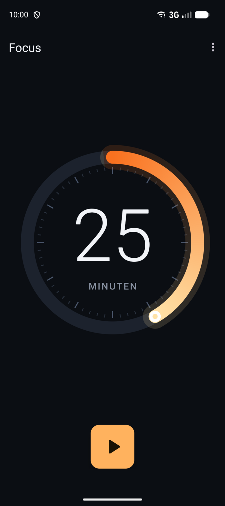
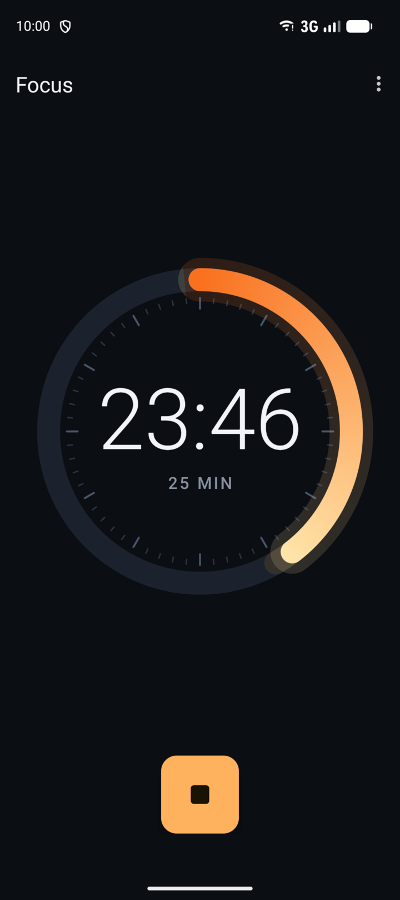
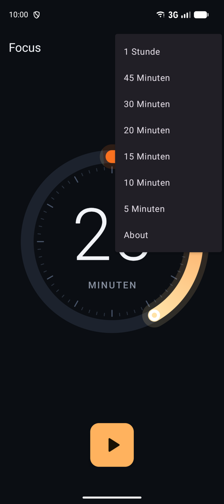

# Konzentrationstimer als App

**Focus** ist ein schlichter Timer für konzentriertes Arbeiten, Lernen oder Hausaufgaben: Dauer
einstellen, starten, und wenn die Zeit um ist, klingelt das Handy. Die Dauer stellt man nicht über
Ziffern ein, sondern wie bei einer Küchenuhr über einen Ring.

## So funktioniert's

Ein voller Ring entspricht einer Stunde. Den Griff am Ring im Uhrzeigersinn ziehen, bis die
gewünschte Zahl an Minuten in der Mitte steht, dann den großen **Play-Knopf** drücken. Während der
Timer läuft, schrumpft das farbige Segment, und in der Mitte steht die Restzeit auf die Sekunde. Am
Ende erscheint eine Benachrichtigung und der Weckton des Geräts spielt, bis man ihn mit demselben
Knopf stoppt.

<table>
<tr>
<td width="33%"></td>
<td width="33%"></td>
<td width="33%"></td>
</tr>
<tr>
<td><b>Einstellen:</b> 25 Minuten am Ring gezogen.</td>
<td><b>Läuft:</b> Restzeit sekundengenau, der Knopf bricht ab.</td>
<td><b>Schnellwahl:</b> feste Zeiten von 5 Minuten bis zu einer Stunde.</td>
</tr>
</table>

## Kleine Details

- **Klingelt zuverlässig:** Der Alarm wird wie ein Wecker beim System angemeldet. Er kommt pünktlich,
  auch wenn das Handy im Stromsparmodus ist oder die App zwischendurch beendet wurde.
- **Bildschirm bleibt an,** solange die App im Vordergrund läuft, damit man die Restzeit sieht.
- **Minutengenau:** Der Ring rastet in ganzen Minuten und hält bei 0 und 60 an, statt
  überzuspringen.
- **Ohne Konto und Internet:** Die App braucht nur die Erlaubnis für Benachrichtigungen und den
  Wecker.

## Ausprobieren

Auf einem Android-Gerät (ab Version 8) die APK-Datei vom
[neuesten Release](https://github.com/hansmaulwurf23/focus/releases/latest) herunterladen und öffnen.
Android fragt einmal, ob Apps aus dieser Quelle installiert werden dürfen, und warnt eventuell, weil
die App nicht aus dem Play Store kommt; beides lässt sich bestätigen. Für iPhones gibt es die App
nicht.
